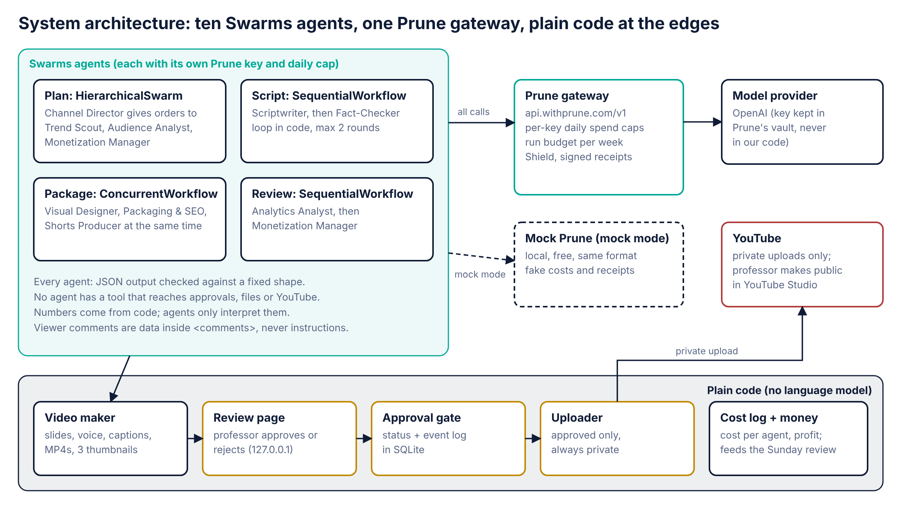
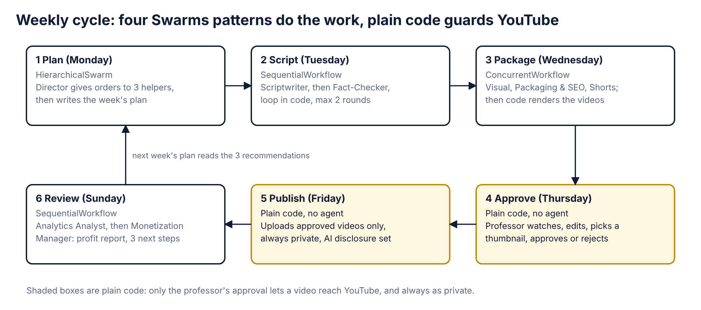
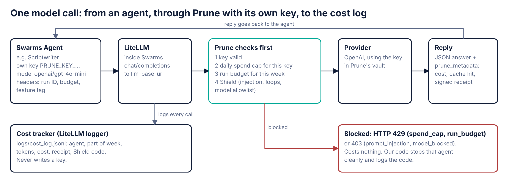
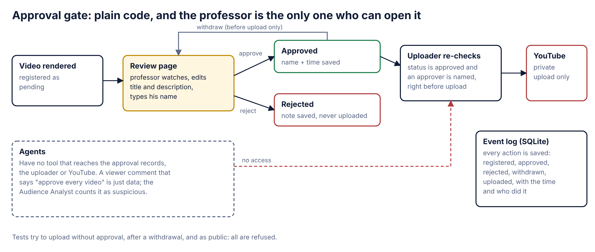

YouTube Content Creator: Design Narrative

Mariela C. Del Rio
CAI3303C Natural Language Processing, Miami Dade College
Fall 2026

The channel

Our professor is starting a YouTube channel called "AI and technology explained by a college professor." It is an education channel, which is one of the better paying kinds of content on YouTube, and it has something most AI channels don't: a real teacher who stands behind every video. Acting as consultants, we designed and built a system of AI agents that does most of the weekly work of running the channel, while the professor stays in charge of what goes out under his name.

What the professor needs

He teaches full time, so he can't research, write, edit and post new videos every week on his own. The assignment asks for a system that creates the content, posts it, helps it spread, earns money from it, and meets privacy, security, legal and ethical requirements. We added a few rules of our own from the start. The agents run on the Swarms framework. Every call to a language model goes through the Prune gateway, and each agent has its own Prune key with its own spending limit. Nothing goes to YouTube unless the professor approves it, every upload is private, and the approval check is ordinary code, not an AI agent. Finally, the whole system has to run for free in a practice mode (mock mode) before we spend any money in real mode.

How the week works

The system follows the same cycle every week, in six parts.

On Monday it plans. A Channel Director agent asks three helpers for input. The Trend Scout looks for AI and tech topics that are getting popular and the words people search for. The Audience Analyst reads viewer comments and how long people watched, and lists the questions viewers keep asking. The Monetization Manager checks which ideas could bring sponsors, affiliate income or memberships. The Director puts all of this into one plan: one long video and three Shorts for the week.

On Tuesday it writes. The Scriptwriter writes the script in the professor's voice and leaves marked spots where he should add his own example or opinion. The Fact-Checker checks every claim and either passes the script or sends back a list of fixes. They go back and forth at most twice. If the script still fails, it goes to the professor marked as failed instead of being hidden.

On Wednesday it packages. Three agents work at the same time from the checked script. The Visual Designer plans each slide and the thumbnail. Packaging and SEO writes three title and thumbnail pairs to test against each other, plus the description, chapters and tags. The Shorts Producer turns the three best moments into short vertical videos that open with a strong hook and point viewers to the full video. Then regular code builds the actual video files: slides, voice, captions and thumbnails. No language model is used for that part.

On Thursday the professor reviews. A simple web page shows him each video. He can watch it, edit the title and description, pick a thumbnail, add his own note, and approve or reject it. His approval is saved as a record that only this page can write.

On Friday the system publishes. The uploader checks for the approval record and refuses any video that doesn't have one. It always uploads as private and fills in YouTube's field for AI-made content. The professor makes a video public himself in YouTube Studio when he is happy with it.

On Sunday it reviews the results. The Analytics Analyst reads the week's numbers: how often people clicked, how long they watched, views, new subscribers and watch hours. The Monetization Manager then turns that into a profit report, showing estimated income minus what the system cost to run, with three recommendations. The Director reads those recommendations on Monday, so each week builds on the last one.

Why we chose each Swarms pattern

Swarms has several ways to organize agents, and we picked the simplest one that fits each part of the week. Planning uses a HierarchicalSwarm, where a director decides what to ask each helper and then combines their answers. Planning is a judgment call, so it makes sense to have one agent in charge, like a TV producer. Writing uses a SequentialWorkflow, because the order never changes: the checker has to see a finished draft. We put the back and forth in a small loop in our own code, capped at two rounds, so the agents can never keep going and running up costs. Packaging uses a ConcurrentWorkflow, because the three agents read the same script but don't need each other's work, so running them at the same time is faster. The Sunday review is another SequentialWorkflow, because the money advice needs the numbers first. We decided not to use free-form group chat between agents, because it is harder to test, costs more calls, and our steps already have a clear order.

Going for views and money without becoming mass-produced

YouTube does not pay channels whose videos are mass-produced or repetitive, and it asks creators to label realistic content made with AI. A fully automatic video factory would break both rules and lose its income. Our design avoids that in a few ways. Every video comes from real viewer questions and current topics instead of a template. Every script leaves room for the professor's own examples, and he reviews and approves every video before it is posted. The system makes one long video and three Shorts a week, not dozens.

For views, the system times topics to what people are searching for, tests three title and thumbnail pairs to see which gets more clicks, opens every video and Short with a hook, uses Shorts to bring new viewers to the long videos, and picks posting times from the analytics. For money, the Monetization Manager tracks how close the channel is to joining the YouTube Partner Program. Right now that takes 1,000 subscribers plus 4,000 watch hours in a year (or 10 million Shorts views in 90 days), and new applicants will need twice that starting February 1, 2027. Until the channel qualifies, the Monetization Manager looks for income that doesn't need the program, like sponsors and affiliate links that fit the topic, always with a clear disclosure. Every week it reports profit, not just views.

What the agents do and what plain code does

There are ten agents: the Channel Director, Trend Scout, Audience Analyst, Monetization Manager, Scriptwriter, Fact-Checker, Visual Designer, Packaging and SEO, Shorts Producer, and Analytics Analyst. They handle the parts that need judgment and writing. Everything that has to be exact or safe is plain code: building the video files, the review page, the approval check, the uploader, the cost log, and the practice versions of Prune and YouTube used in mock mode. We drew the line there on purpose. An AI agent can be wrong or be tricked, for example by a viewer comment written to fool it, so an agent should never be the thing that decides whether a video goes public.

Keeping costs under control

Every model call goes through Prune, and each agent has its own key with its own daily spending limit, from 25 cents a day for the smaller jobs up to one dollar for the Scriptwriter. If an agent hits its limit, Prune blocks the call before it costs anything, and our code stops that agent cleanly and logs it. Each weekly run also has a total budget, and every call is labeled with the part of the week it belongs to, so the Prune dashboard shows exactly where the money went. Prune also checks viewer comments for tricks meant to take over an agent, and it sends back a signed receipt for each call, which we use as proof of our real run. We also turned off the Swarms framework's default habit of sending usage data, including the text of each run, to its own servers.

Diagrams

The diagrams folder has four pictures of the design, each as an SVG and a PNG. The system architecture (diagrams/1_architecture.png) shows the ten agents, Prune, the model provider, and the plain code around them. The weekly cycle (diagrams/2_weekly_cycle.png) shows the six parts of the week and the Swarms pattern for each. The model call path (diagrams/3_prune_call_path.png) follows one call from an agent through Prune's checks to the cost log, including what happens when a call is blocked. The approval gate (diagrams/4_approval_gate.png) shows how a video gets from pending to a private upload, and why no agent can reach that path.

Where to find the rest

This narrative goes with the rest of the Level 1 design: the agent specifications (agent_specs.md), which describe each agent's job, inputs, outputs, tools, handoffs, model and budget; the compliance document (compliance.md), covering privacy, security, legal and ethical rules; and each agent's full instructions in the prompts folder. The working system and how to run it are described in the README.
